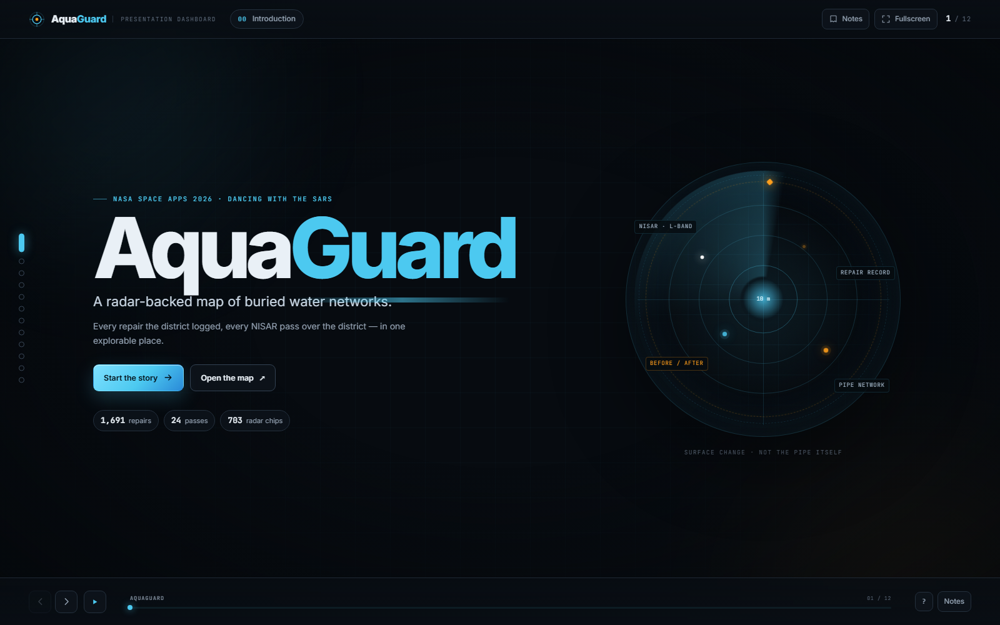
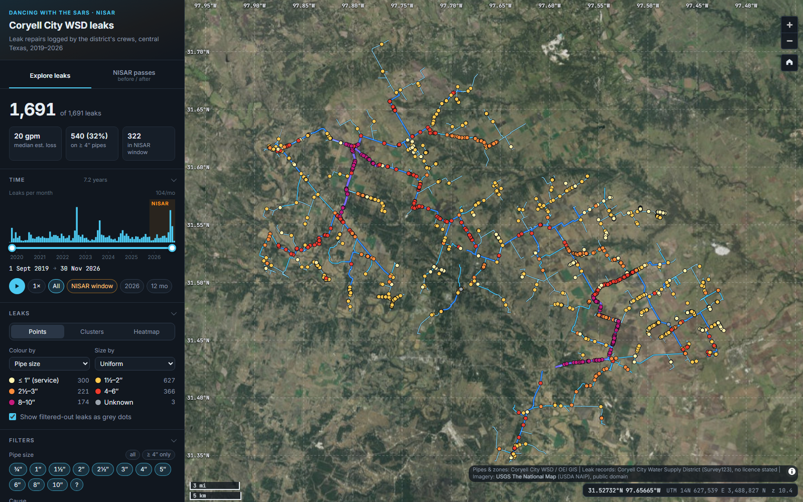
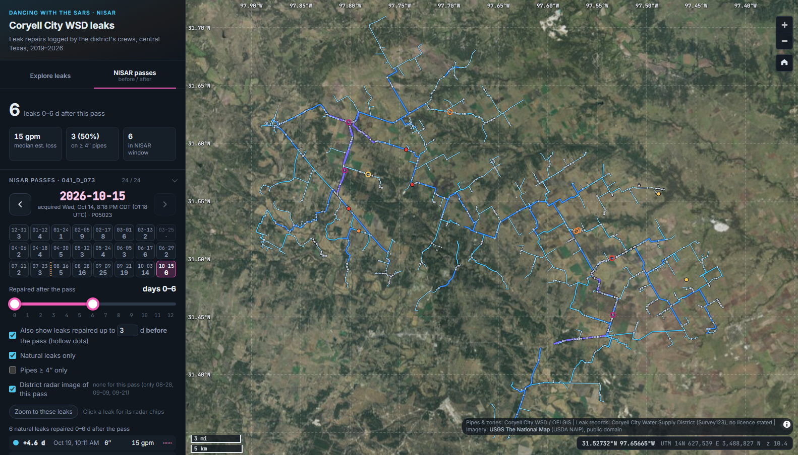
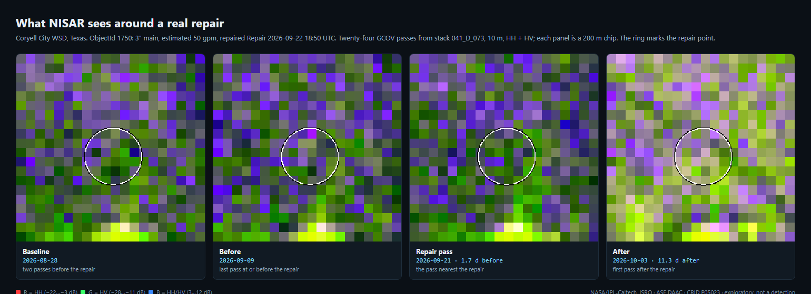

# AquaGuard

### A radar-backed map of buried water networks

**NASA Space Apps Challenge 2026 — "Dancing with the SARs"**

AquaGuard puts **NISAR L-band radar** next to **seven years of real water-main repairs** in a rural Texas utility. Step through 24 satellite passes, open the ground around a repair before and after it was fixed, and see where the radar changes — and where it does not.

[](presentation/)

The submission has two entry points:

- **[`viz/`](viz/)** — the interactive map, the NISAR pass browser and the before/after radar viewer.
- **[`presentation/`](presentation/)** — a 12-slide guided story with speaker notes, built around the same map and data.

Both are plain HTML, CSS and JavaScript. No build step, no framework, no API key.

---

## The idea

The challenge asks for an interactive application that uses NISAR to track and visualise surface change, explain the physical drivers, and stay open source.

We chose buried water infrastructure. A leaking pipe is invisible from orbit, but the wet soil around it is a surface change. NISAR's L-band (24 cm wavelength) penetrates vegetation and dry soil better than C-band, responds to soil moisture and surface roughness, and works at night and through cloud.

The important move is what we compare. We do **not** start from "find a leak". We start from the district's own repair log: **1,691 GPS-located repairs** between 2019 and 2026. For each repair inside the NISAR window, the app shows, where the passes exist:

- the last pass **before** the repair,
- the first pass **after** it,
- a **baseline** pass before that.

The question becomes concrete: *did the radar change around this point in the way wet soil should?* The app shows the evidence; it does not pretend to answer that with a verdict.



*The exploration view: 1,691 logged repairs, 918 pipe segments, seven pressure zones, filters, a time animation and a monthly repair histogram. The highlighted band is the NISAR window.*

## What we built

### 1. Explore the repair record

A MapLibre map of the Coryell City Water Supply District in central Texas. Every point is a repair logged by a crew on site, not a satellite detection.

- Filter by pipe size and cause; colour by pipe size, water loss, cause or year; size by loss or diameter.
- Switch between points, clusters and a heatmap.
- Drag the two-handle time slider, click a month, or press play to animate 2019–2026.
- The histogram and summary tiles follow the filters.
- The optional **Leak risk by pipe** layer colours pipe pieces by their monthly risk rank. It is trained on leak history and pipe attributes only — no radar.

### 2. Step through the NISAR passes

The visualisation uses one NISAR stack: **track 41 descending, frame 73 (`041_D_073`)**, 24 calibrated GCOV passes from **2025-12-31 to 2026-10-15**, about every 12 days.

The pass browser shows which repairs were logged in the hours and days after each acquisition. The strip is gap-aware: the permanent **2026-07-27 to 2026-08-10** data gap is marked, and dates outside the P05023 run are absent.

- Choose a window of 0–12 days after the pass.
- Optionally show repairs logged just **before** the pass as hollow dots.
- Filter to natural leaks, or to mains of 4 inches and larger.
- Click a repair to open its radar chips.
- For three dates (2026-08-28, 2026-09-09 and 2026-09-21) a whole-district false-colour image is available.



*The pass browser: 24 passes, the 0–6 day window, the date strip and the repairs that follow each acquisition.*

### 3. Compare before and after

The before/after viewer opens three **1.2 km chips at 10 m** around a selected repair:

- **baseline** — the pass before the "before" pass,
- **before** — the last pass at or before the repair time,
- **after** — the first pass after it.

Each chip is shown in false colour (R = HH, G = HV, B = HH/HV) or as HH or HV alone, with a fixed stretch shared across dates. The viewer draws a 30 m statistics disc and 100 m / 300 m background rings, reports mean γ⁰ inside and outside the disc, and plots the change between passes. A **Blink** button alternates before and after on the map.



*Four NISAR passes around ObjectId 1750: a 3-inch main, an estimated 50 gpm, repaired 2026-09-22. Each chip is 200 m across; the ring marks the repair point. From the committed NISAR chip package, using the same stack and stretch as the viewer.*

### 4. Rank pipes by break risk

The risk layer is a separate, radar-free view. The 918 pipe segments are cut into pieces of at most 250 m, and each piece × month is scored from:

- leaks on the piece and within 200 m / 500 m, strictly before the month;
- months since the last leak;
- pipe length, diameter, material and pressure zone;
- month of year.

The target is at least one non-construction repair on the piece in that month.

A gradient-boosted classifier is trained on **October 2020 → October 2025** and evaluated on the 12 held-out months **November 2025 → October 2026**. The 12-month holdout gives **AUC ≈ 0.79**, and the riskiest 5% of pipe-months contain **32% of the held-out leaks**. On the independent chip test split, the same score reaches AUC ≈ 0.79 (594 samples, 54 leaks). The ranking uses no radar. It is a prioritisation tool, not a leak forecast.

The ranking and its numbers are documented in [`viz/README.md`](viz/README.md). The risk layer is an optional extra in the map. The presentation deck deliberately focuses on the repair record and the radar viewer, so the two views never get confused: one ranks pipes from infrastructure history; the other shows what the radar saw.

### 5. Tell the story

[`presentation/`](presentation/) is a 12-slide deck with live map, pass chart and before/after viewer slides, plus speaker notes. It is the fastest way to see the story; the live map and radar slides use the same local data and work after the build.

### How it meets the brief

| The challenge asks for | What AquaGuard does |
|---|---|
| A study area | Coryell City Water Supply District, central Texas: rural mains under pasture, crops and scrub |
| Freely available NISAR data | 24 L-band GCOV passes, 10 m, HH + HV, from ASF DAAC |
| An interactive medium | Map, pass browser, before/after viewer, 12-slide deck; all static HTML/JS |
| A time dimension | 24 radar passes alongside a 2019–2026 repair record |
| Context | Pipe network, pressure zones, land cover, hillshade, imagery |
| Physical drivers | Wet soil raises the dielectric constant and usually HH; HV follows vegetation volume; contrast against the surroundings separates local wetting from regional weather |
| Which polarizations show the change | HH is the primary soil-moisture channel; HV separates vegetation structure; HH/HV is shown as the third channel |
| Storytelling | The district's own repairs, water loss, the NISAR data gap and an explicit negative result |
| Open source | MIT code, plain JavaScript, Python data scripts, publicly documented data sources |
| Future applications | Calibrated L-band, GUNW ground motion, SME2 soil moisture, more districts, field-validated triage |

## By the numbers

| | |
|---|---|
| Repair records | **1,692** (2019-09-30 → 2026-11-11); **1,691** plotted after dropping one test entry |
| Repairs inside the NISAR window | **322** (on or after 2025-10-17) |
| Pipe network | **918** segments, about **624 km**, **7** pressure zones |
| NISAR stack | **24** GCOV passes, track 41 descending, frame 73, CRID **P05023** |
| NISAR pixels | **10 m**, HH + HV, dual-pol |
| Radar chips | **703** chips (baseline / before / after roles), 1.2 km at 10 m |
| District images | **3** dates at 20 m |
| Risk model | AUC ≈ **0.79**; top 5% of pipe-months capture **32%** of held-out leaks |
| Confirmed leak detections from radar | **0** — this is a screening tool, not a detector |

## Data

| Layer | Source | What it gives us |
|---|---|---|
| Leak repairs | Coryell City Water Supply District, Survey123 via the district's ArcGIS consultant | 1,692 field-logged repairs with coordinates, date, pipe size, estimated loss, cause and zone |
| Pipes and pressure zones | CCWSD / OEI GIS, `CCWSDWaterline2026` and `CCWSD_Leak_Density_WFL1` | 918 water-line segments, 7 pressure planes |
| NISAR GCOV | NASA/JPL-Caltech, ISRO; ASF DAAC | 24 passes of L2 GCOV, 10 m, HH + HV, P05023 |
| Basemaps | USGS The National Map, Esri, EOX Sentinel-2 cloudless, OpenStreetMap, OpenTopoMap | Imagery and geographic context |
| Land cover | USGS/MRLC NLCD 2021; ESA WorldCover 2021 | Pasture, crops, trees and built-up context |
| Terrain | USGS 3DEP hillshade | Creek valleys and relief |

NISAR facts that matter for reading the map:

- The stack is **one track, one frame, one direction**. Dates are only compared within it.
- **P05023 is a PROVISIONAL processing run.** BETA and later VALIDATED files are not mixed into the stack, because differences between processing versions can look like surface change.
- The NISAR science archive begins **2025-10-17**, but this single-CRID run begins **2025-12-31**. Repairs before that cannot have a before/after pair in this stack.
- The district images have approximate georeferencing; the chips are cut on the native UTM grid and are the reliable layer.

Full field definitions, caveats and licence notes: [`data/coryell/README.md`](data/coryell/README.md).

## How it works

### From a granule to a chip

```
scripts/fetch_coryell_data.py       vectors, NISAR frame footprints
scripts/make_leak_chips.py          acquisitions, 703 chips, leak_chips.json
scripts/subset_gcov.py              whole-district GCOV subset
scripts/render_gcov_png.py          false-colour district images
viz/                                the map, pass browser and viewer
```

`make_leak_chips.py` reads only the windows it needs from each 7 GB granule over HTTPS, using `h5py` and HTTP range requests. No full granule is downloaded. A run reads 24 granules, writes 703 chips and transfers about **1.4 GB**.

Each chip is 120 × 120 pixels at 10 m in UTM zone 14N, north-up. Linear γ⁰ is boxcar-filtered 3 × 3, converted to dB, and encoded with a fixed stretch so dates are comparable.

### From chips to evidence

For every leak and pass, the viewer reports:

- mean γ⁰ in a **30 m disc** around the repair;
- mean γ⁰ in a **100–300 m annulus** around it;
- **contrast** = disc − annulus;
- change from baseline to before, and from before to after.

Contrast is the useful quantity. A regional wetting event moves both the disc and the annulus; a leak-scale patch moves the disc more. Single-pass speckle on a 30 m disc is about **±1 dB**, so changes under roughly 1.5 dB are noise.

### The physics in one paragraph

Water has a high dielectric constant (εᵣ ≈ 80, against 3–5 for dry soil). Wet soil therefore raises co-polarised backscatter, usually HH. HV is dominated by vegetation volume, so it helps separate a wet surface from a change in vegetation structure. The HH/HV ratio is sensitive to the difference. Smooth standing water can instead lower HH by reflecting the pulse away, and dense vegetation can mask the soil. That is why the viewer shows all three channels and the surrounding annulus, not a single bright pixel.

## What the data says

The product is complete and reproducible, but the scientific result is deliberately modest.

- The radar chips are **exploratory**. They show what the ground looked like on the passes around a repair; they do not establish that a leak was present.
- A separate pre-registered test on a held-out NISAR track found **no replicable leak signal**: the discovery stacks suggested a +0.25 dB HH drop after repair, but the held-out stack gave **−0.03 dB [−0.24, +0.19], p = 0.76** (37 testable leaks). The confirmation failed. See [`asen_results/docs/CORYELL_CONFIRMATION_PREREG.md`](asen_results/docs/CORYELL_CONFIRMATION_PREREG.md).
- The infrastructure risk model is the strongest quantitative result: **AUC ≈ 0.79** and **32%** of held-out leaks in the top 5% of pipe-months, without any radar input.
- In a separate urban study (Kitchener, Ontario) the NISAR pipeline is also complete: **3,026 break records**, 143 GCOV granules, and a break-risk model at **AUC 0.907**. Adding NISAR features did not improve it. See [`asen_results/docs/DATA_PIPELINE_REPORT.md`](asen_results/docs/DATA_PIPELINE_REPORT.md).

This is the honest reading: **the map is a place to look, not a verdict.** It makes the radar evidence inspectable, attaches its uncertainty, and defines what the next iteration needs — more passes, calibrated L-band products, ground truth at the moment of leakage, and field validation.

## Run it

### View the app

From the repository root:

```bash
python -m http.server 8000
```

Then open:

- <http://localhost:8000/viz/> — the interactive map.
- <http://localhost:8000/presentation/> — the 12-slide deck.

The browser needs an internet connection for MapLibre, the basemaps and the WMS layers. The HTML will not work from `file://` because browsers block local `fetch()` requests.

### Build the local data

`data/coryell/` is git-ignored. A clean clone has the code and the committed screenshots, but not the district data or the radar chips.

```bash
# 1. District layers and NISAR frame footprints. No login, seconds.
python scripts/fetch_coryell_data.py --steps vectors,footprints

# 2. NISAR chips and district images. Free Earthdata login, ~1.4 GB + 180 MB per date.
python scripts/fetch_coryell_data.py --steps chips,images

# 3. Optional: the pipe-risk layer (needs the vectors from step 1).
cd asen_results
pixi run coryell-risk
```

Step 2 needs a free Earthdata login. Put it in `~/.netrc` (`C:/Users/<you>/.netrc` on Windows):

```
machine urs.earthdata.nasa.gov
    login <username>
    password <password>
```

Never commit that file. The chips step takes about 5–10 minutes with `--workers 6`; the district images take about 4 minutes each. The risk step needs the `asen_results` pixi environment, not Earthdata. Without steps 2 and 3, the map still shows the repairs, pipes and zones, and the NISAR tabs explain what is missing.

## What this is not

- **Not a leak detector.** The points are logged repairs, not confirmed detections. A bright pixel is not a leak.
- **Not a substitute for the crew.** Field verification (acoustic, GPR, visual) is required before any repair decision.
- **Not metre-scale.** A 10 m pixel is 100 m²; a 0.1–0.6 m pipe occupies a tiny fraction of it. The viewer ranks a corridor; it cannot point to a pipe joint.
- **Not a long time series.** NISAR has about one year of data here. Many repairs have no before or after pass, and the 12-day revisit samples snapshots, not continuous leakage.
- **Not a single-sensor answer.** Irrigation, harvest, soil texture, construction and regional wetting produce the same surface signatures. The app exposes the ambiguity instead of hiding it.

## Privacy and licences

The repair layer is publicly queryable but has **no stated open-data licence**. It is used here for the hackathon; credit the Coryell City Water Supply District and OEI GIS. Ask the district before any use beyond this event.

Privacy rules are built into the map:

- `Creator` and `Editor` staff account names are never read into the page.
- Notes that name people are withheld at display time.
- Raw free-text water-loss entries are never shown; only the parsed number is.
- The meter and parcel layers, which contain customer and owner names, are not used.
- The test record near Galveston is dropped.

Data credits: NISAR GCOV — NASA/JPL-Caltech, ISRO, ASF DAAC. Basemaps — USGS The National Map, Esri, EOX (Sentinel-2 cloudless, CC BY-NC-SA 4.0), OpenStreetMap contributors (ODbL), OpenTopoMap (CC BY-SA). Land cover — USGS/MRLC NLCD 2021 (public domain), ESA WorldCover 2021 (CC BY 4.0). Code — MIT, see [`LICENSE`](LICENSE).

## Repository map

| Path | Contents |
|---|---|
| [`viz/`](viz/) | The submission: map, NISAR pass browser, before/after viewer, risk layer |
| [`presentation/`](presentation/) | 12-slide story deck with live map and radar slides |
| [`scripts/`](scripts/) | Data fetching, NISAR chip cutting, GCOV rendering |
| [`data/coryell/`](data/coryell/) | Data notes; the data files themselves are git-ignored |
| [`docs/`](docs/) | Earlier Sentinel-1 solution design and results (Bulgaria), plus the screenshots used here. The Coryell story is this README and [`viz/README.md`](viz/README.md) |
| [`asen_results/`](asen_results/) | NISAR pipeline over Kitchener: GCOV, GUNW, SME2, break-risk model |
| [`chris-results/`](chris-results/) | Four-site Sentinel-1/2 evidence explorer (Bulgaria, Aguascalientes, Calgary, Coryell) |
| [`iliya-results/`](iliya-results/) | Gold/silver leak candidates matched to NISAR scenes across 14 utilities |
| [`pesho_coryell_data_package/`](pesho_coryell_data_package/) | 3,014-sample NISAR chip dataset with matched negatives and train/test split |
| [`research/`](research/) | Literature review, data audits and the NISAR coverage notes |

### Supporting evidence in this repository

The Coryell viewer is the submission, but the same question was tested at larger scale:

- **Kitchener, Ontario** — 3,026 water-main breaks joined to 143 NISAR GCOV granules, 71 GUNW pairs and 77 SME2 soil-moisture dates. The pipeline is reproducible; the direct leak signal is not detectable at 10 m, and NISAR features do not improve the break-risk model. [`asen_results/docs/DATA_PIPELINE_REPORT.md`](asen_results/docs/DATA_PIPELINE_REPORT.md)
- **Four-site Sentinel-1 case studies** — an expected-condition model for Bulgaria, Aguascalientes, Calgary and Coryell. The Bulgarian corridor test is negative and reported openly. [`chris-results/README.md`](chris-results/README.md)
- **Gold/silver NISAR candidates** — 1,259 leak records (411 rural) from 14 utilities, matched to the NISAR scenes most likely to have caught them leaking. [`iliya-results/README.md`](iliya-results/README.md)
- **Coryell ML package** — 3,014 chips (274 leak repairs + 2,740 matched negatives), four passes per sample, grouped train/test split, with an exception-mask audit. [`pesho_coryell_data_package/README.md`](pesho_coryell_data_package/README.md)

## What comes next

1. **More passes.** Re-run the pre-registered Coryell test in early 2027, when the September–October 2026 repairs have after passes.
2. **More districts.** The pipeline is generic; a second rural utility would test transferability.
3. **Calibrated NISAR products.** The current viewer uses GCOV; GUNW ground motion and SME2 soil moisture are the natural next layers.
4. **Field validation.** The right end state is a ranked inspection list the district can check, with the false-alarm rate measured per kilometre per year.
5. **Operational view.** A live refresh of the pass browser and a crew-facing triage screen, not a hackathon demo.

## Credits

Built for the **NASA Space Apps Challenge 2026**, challenge **"Dancing with the SARs"**, by the AquaGuard / Dancing with the SARs team.

NISAR data are produced by NASA and ISRO and distributed by the Alaska Satellite Facility. The repair, pipe and pressure-zone records are published by the Coryell City Water Supply District and its GIS consultant. The map is built with [MapLibre GL JS](https://maplibre.org/).
