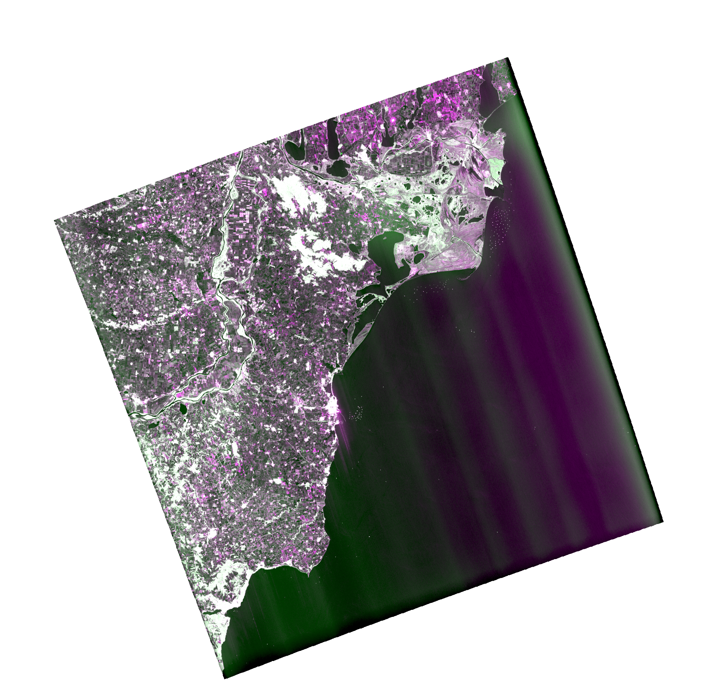

# NISAR GCOV — onboarding notes (Dancing with the SARs)

_Compiled 2026-11-14. Challenge brief: [../CHALLENGE_DESCRIPTION.md](../CHALLENGE_DESCRIPTION.md)._

## Fit with the brief (read this first)
The brief asks for an **interactive app that tracks and explains *Earth-surface* change** (floods, wetlands, coasts, human impact), with NISAR central, plus multitemporal and polarization analysis and scientific interpretation. Pure ship tracking is a maritime-surveillance problem, not surface change, so on its own it risks being judged off-theme. Recommended framing that keeps the Black Sea and ships:

**"Black Sea Coastal Watch"**: the western shelf, from the Danube delta to Constanța and Odesa (the best NISAR coverage in the sea).
1. **Human pressure, ships (HV):** vessel counts and anchorage queues per pass, with anomalies flagged.
2. **Environmental consequence, oil slicks (HH):** dark, smooth patches near shipping lanes and anchorages. A classic SAR use, and it ties ships to environmental impact.
3. **Surface change, Danube delta water and wetland extent (HH/HV, multitemporal):** flooding, seasonal inundation, sediment and shoreline change. This fits the brief squarely.

The UI is a map with a date slider, a before/after swipe, change overlays and short "what this means" explainers. Measured facts and hypotheses are kept visibly separate, as the brief asks.

## What NISAR / GCOV is
- **NISAR**: NASA–ISRO SAR, launched 2025-07-30. **L-band (24 cm)** from NASA (global), S-band from ISRO (mostly India, separate portal). 12-day repeat cycle, ~240 km swath.
- **GCOV** = Level-2 *Geocoded Polarimetric Covariance*: calibrated, terrain-corrected backscatter (**γ⁰, linear power, float32**), already map-projected (UTM between 60°S–60°N). Analysis-ready — like Sentinel-1 RTC.
- Pixel spacing: **Frequency A 10–20 m** (Black Sea data is mode `2005` → 20 MHz → **20 m**), Frequency B 80 m.
- Black Sea acquisitions are **DHDH** = dual-pol **HH + HV** → datasets `HHHH`, `HVHV`.
- Files: HDF5, **~1.7–1.9 GB each**. Stream subsets instead of downloading (see script).
  - `/science/LSAR/GCOV/grids/frequencyA/{HHHH,HVHV,numberOfLooks,mask,rtcGammaToSigmaFactor}`
  - Coordinates: `xCoordinates`, `yCoordinates`, `projection` in the same group (**to verify** with `inspect`).
- Naming: `NISAR_L2_PR_GCOV_<cycle>_<track>_<A|D>_<frame>_<mode>_<pols>_A_<start>_<end>_<CRID>_..._001.h5`

### Data maturity
| Collection (earthaccess short_name) | Covers | Notes |
|---|---|---|
| `NISAR_L2_GCOV_V1` (VALIDATED) | 2026-10-21 → now | released 2026-11-06 |
| `NISAR_L2_GCOV_PROVISIONAL_V1` | 2026-06-17 → 2026-10-23 | calibrated, partly validated |
| `NISAR_L2_GCOV_BETA_V1` | late 2025 → early 2026 | pre-calibration, known issues |

Permanent gap: 2026-07-27 → 2026-08-10.

## Access
- **Searching is open**: NASA CMR / Vertex / Earthdata Search, no login needed. **Browse PNGs are public**.
- **Downloading/streaming needs a free Earthdata Login**: https://urs.earthdata.nasa.gov (each teammate should create one now).
- Tools: `asf_search` (`asf.search(dataset='NISAR', processingLevel='GCOV')`), `earthaccess`, GDAL ≥ 3.13 (`/vsicurl/`), QGIS ≥ 4.2.
- Browser: https://search.asf.alaska.edu/#/?dataset=NISAR&sciProducts=GCOV · Worldview has a GCOV layer.
- Docs: https://nisar-docs.asf.alaska.edu/gcov/ · spec PDF (D-102274 Rev F) linked from that page.

## Black Sea coverage (measured from CMR, Jun 17 – Nov 5 2026, 851 granules)
NISAR plans acquisitions around land, so **only the coastal band is imaged; the deep central Black Sea has no data.**

- Well covered (~20–40 dates in 5 months, i.e. every ~4–7 days): **the whole western shelf** (Bosporus approaches, Burgas, Varna, Constanța, Danube delta, Odesa / Ukrainian ports), Crimea, Kerch Strait, Sea of Azov, Novorossiysk, the Turkish coast.
- Not covered: roughly 31.5–38°E × 42.5–44°N (the open centre).
- Example, Constanța: 21 granules from Sep 1 to Nov 14 across 3 tracks (028A, 065D, 100A).
- The western shelf includes the Ukrainian grain-corridor route (Odesa → Romanian/Bulgarian waters → Bosporus), which is a strong storyline.


*Danube delta (top) to Constanța (middle). The bright dot clusters offshore are ships at anchorage, visible even in the browse image.*

## Ship-monitoring idea: how it maps onto the data
1. **Detect ships** in each pass. In HV, metal hulls are bright and the sea is dark. Use CFAR thresholding (starter in `scripts/nisar_blacksea.py`). At 20 m pixels, ships ≳ 40–50 m (cargo ships, tankers) are reliable; small boats are not.
2. **Change over time**: compare anchorage and port counts across passes (queues at Constanța / Bosporus, port activity at Odesa / Novorossiysk), then flag anomalies relative to the baseline.
3. **"Dark vessel" angle**: cross-match detections against AIS. Vessels with no AIS signal are the "unusual" ones. AIS sources: Global Fishing Watch (also publishes Sentinel-1 vessel detections) and MarineTraffic/AISHub (limited).
4. **Bonus layers**: oil slicks (dark smooth patches), offshore platforms (persistent detections, which should be masked).

### Caveats to plan around
- NISAR alone doesn't track individual ships: it gives snapshots every few days, not continuous tracks. Frame the product as "change and anomaly detection at chokepoints and ports".
- Sea clutter in L-band is low, which helps ships stand out. The browse image does show stripe artifacts over water, so check `mask` / `numberOfLooks`.
- Mask land before detection (a buffered coastline polygon), or every pier and breakwater counts as a "ship".
- 2 GB files: stream crops of `HVHV` only, and limit work to a few hotspots.
- **Complementary data**: Sentinel-1 (C-band, 10 m, also free, ESA/Copernicus) can fill gaps and validate.

## Starter script
```bash
pip install earthaccess h5py numpy scipy matplotlib pyproj
python scripts/nisar_blacksea.py search "28.5,43.8,29.5,44.4" 2026-09-01 2026-11-14   # no login
python scripts/nisar_blacksea.py inspect <h5 url from granules.json>                  # verify dataset names
python scripts/nisar_blacksea.py ships   <h5 url> "28.6,43.9,29.2,44.3"                # CFAR → detections.csv/png
```
