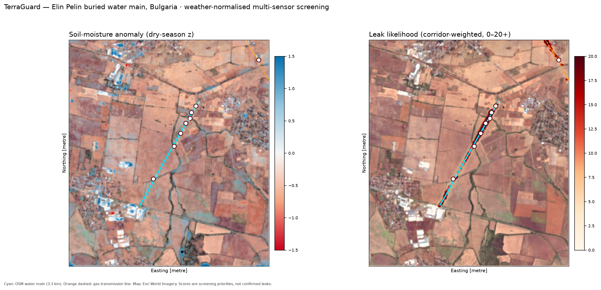

# AquaGuard

**Satellite leak screening for buried water pipelines — NASA Space Apps 2026, "Dancing with the SARs".**

> **New in the `test` branch:** open the unified evidence explorer at `app/index.html`
> (serve the bundle root, then <http://127.0.0.1:8766/app/>). It brings the Bulgarian demo,
> Aguascalientes, Calgary and the new Coryell case into one MapLibre platform.
> See [`docs/PLATFORM.md`](docs/PLATFORM.md). The original dashboard and maps remain as a legacy appendix.

AquaGuard learns what a 20 m patch of farmland *should* look like given rainfall, soil, vegetation,
season and evapotranspiration, then flags ground that stays wet (and cool) when the weather says it
should dry. The flags are constrained to a mapped water main and ranked as inspection candidates.



## The honest result

The pipeline is working end-to-end and the expected-condition models are skilful
(Sentinel-1 VV: MAE 1.77 dB, R² 0.61; Sentinel-2 NDMI: MAE 0.178, R² 0.47 on a 2026 holdout).

But the 3.3 km water main is **not** statistically enriched in dry-season moisture anomalies
compared with 200 translated placebo corridors (p = 0.57 for the mean, p = 0.89 for the 95th
percentile). The AOI has no confirmed leak. The map is therefore a **screening-priority map**, not a
leak detection. This negative validation is reported openly; it is the scientifically correct
result and it defines what the next iteration needs (calibrated NISAR L-band, ground truth,
hydraulic data).

Read the full story in [`docs/RESULTS.md`](docs/RESULTS.md) and the challenge-facing design in
[`docs/SOLUTION.md`](docs/SOLUTION.md).

## What is in the box

- `app/` — unified MapLibre evidence explorer: Overview / four sites / Compare / Method.
- `case_studies/coryell/` — fourth Sentinel-1 case: `case.json`, 72 labels, 55 dates, outputs.
- `outputs/aquaguard_map.html` — legacy self-contained interactive map (open it directly; no server or API key).
- `outputs/aquaguard_map.png` — two-panel static map.
- `outputs/corridor_profile.png` — moisture residual and leak score along the 3.3 km main.
- `outputs/hotspots.csv` / `.json` — ranked candidates with evidence.
- `outputs/validation.json` — temporal holdout, placebo-corridor test, data counts.
- `outputs/*.tif` — GeoTIFFs of moisture anomaly, leak likelihood, persistence, thermal, confidence.

## Quick start

```bash
# Pixi environment (conda-forge; pinned by pixi.lock)
~/.pixi/bin/pixi install

# 1. OSM pipeline geometry (Overpass, public)
~/.pixi/bin/pixi run pipelines

# 2. Acquire Sentinel-1 RTC, Sentinel-2, Landsat, ERA5 and static layers
~/.pixi/bin/pixi run acquire

# 3. Expected-condition model, residuals, validation, hotspots
~/.pixi/bin/pixi run model

# 4. Interactive map and static figures
~/.pixi/bin/pixi run map

# 5. Open the map (the HTML also opens directly from disk)
~/.pixi/bin/pixi run serve
# http://127.0.0.1:8765/aquaguard_map.html
```

Runtime: acquisition is the long pole (10–20 min; Sentinel-1 is 434 dates), model ~5 min, map <1 min.
The `data/` directory is git-ignored because the raw stacks are ~190 MB; the small static/vector
layers and all outputs are included.

## Study area

**Elin Pelin, Sofia Province, Bulgaria** — 5.5 × 6.3 km of farmland crossed by a 3.3 km buried water
transmission main (OpenStreetMap way `1106343159`, `substance=water`, `location=underground`).
Analysis grid: 20 m, EPSG:32634 (UTM 34N), 277 × 314 pixels.

## Data

| Layer | Source | Used for |
|---|---|---|
| Sentinel-1 RTC, C-band, 10 m | Planetary Computer (`sentinel-1-rtc`) | 434 dates 2018–2026; 194 dates 2022–2026 in the model; orbit 7 descending, 100% AOI coverage |
| Sentinel-2 L2A, 10/20 m | AWS Earth Search (`sentinel-2-l2a`) | NDMI, NDVI, SCL cloud mask; 195 cloud-screened dates |
| Landsat C2 L2 thermal | Planetary Computer (`landsat-c2-l2`) | 75 dates; local LST anomaly (100 m native) |
| ERA5 weather | Open-Meteo archive | rainfall lags, temperature, ET₀, soil moisture, VPD, dry spells |
| SoilGrids, WorldCover, Copernicus DEM | ISRIC / ESA / AWS | soil texture, land cover, elevation, slope |
| NISAR GCOV browse, L-band | ASF public browse | 2026-06-20 and 2026-10-06, HH/HV change — display-only, approximate georeferencing |
| OSM pipelines | Overpass API | water main, gas line, 60 m inspection corridor |

**NISAR HDF5 note:** the calibrated GCOV HDF5 download requires Earthdata authentication. The
extraction path is implemented in `scripts/nisar_extract.py --hdf5` and validated on ASF's public
sample, but the Bulgaria HDF5s were not downloaded. The public browse layer is shown for L-band
context and is *not* used in the quantitative score. Details: [`research/nisar-audit.md`](research/nisar-audit.md).

## Method

1. Align every sensor to one 20 m grid (per-item CRS handling, adjacent RTC tile mosaicking, S2 BOA
   offset, SCL/QA cloud masks, Landsat ST_B10 conversion).
2. Build a per-pixel/date feature table: SAR backscatter, NDMI/NDVI, LST, rainfall lags, temperature,
   ET₀, soil moisture, VPD, dry-spell length, season, soil texture, land cover, DEM/slope.
3. Train LightGBM regressors for VV and NDMI; compute residuals against the expected condition.
4. Aggregate the residual z-scores over the dry seasons (June–September), add persistence and thermal
   cooling, smooth to the 60 m plume scale.
5. Weight by distance to the mapped water main, score hotspots, validate against placebo corridors.
6. Render a self-contained Leaflet map with evidence cards and a residual time series per hotspot.

## Repository layout

```
pipeline/          acquisition, features, model, map
scripts/           OSM extraction, NISAR browse/HDF5 extraction
docs/              SOLUTION.md (design), RESULTS.md (implementation + metrics)
research/          literature review, data audit, static-data audit, NISAR audit
data/              raw/interim/static/vector/met data (raw is git-ignored)
outputs/           map, figures, GeoTIFFs, hotspots, validation
pixi.toml          pinned environment and tasks
```

## Limitations

- No confirmed leak in the AOI; the corridor enrichment test is not significant.
- 20 m pixels cannot localise a leak to a metre; 100 m native thermal cannot resolve a pipe-scale halo.
- Irrigation, crop rotation, harvest, soil texture and construction produce the same surface signatures.
- NISAR browse is 8-bit, ~160 m, approximately georeferenced; calibrated HDF5 is the next step.
- ERA5 is a reanalysis at one grid cell, not a local rain gauge.
- Field verification (acoustic, GPR, ERT, visual) is required before any repair decision.

## Licence

MIT. See [`LICENSE`](LICENSE). Data licences: Copernicus Sentinel data, NASA/ASF NISAR browse,
USGS Landsat, ISRIC SoilGrids, ESA WorldCover, OpenStreetMap ODbL, Open-Meteo/ERA5.
